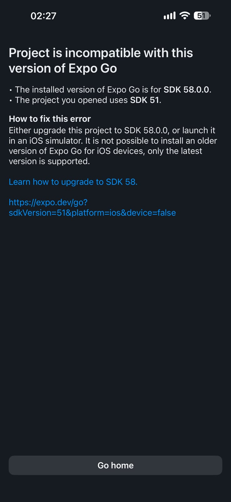
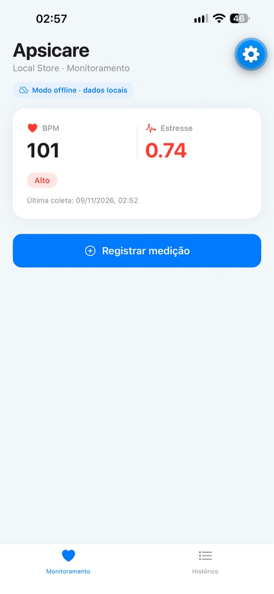
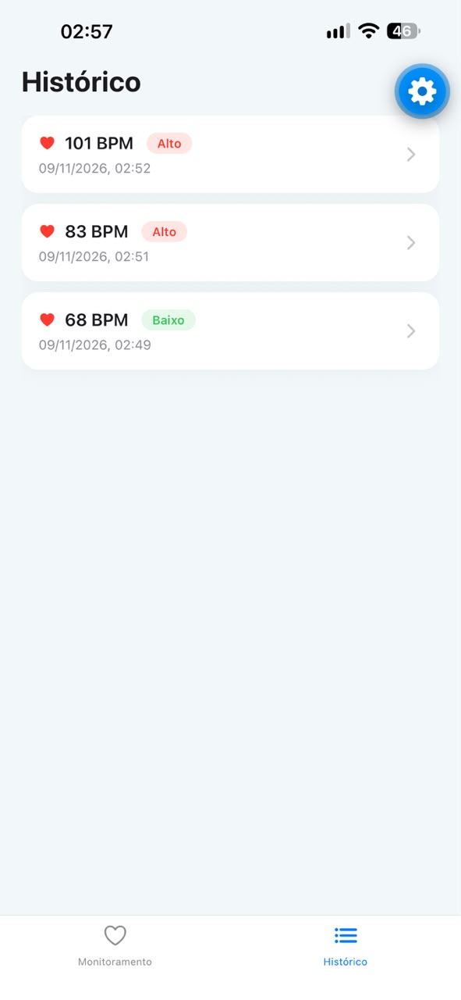
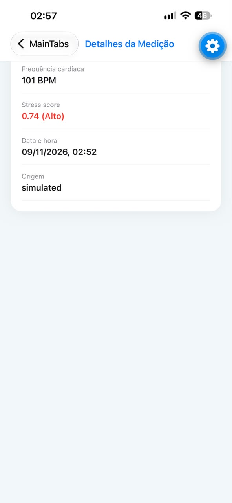

# Critérios de Aceitação — Apsicare Local Store

Verificação manual. Marque `[x]` somente após testar no dispositivo.

| # | Critério | Como testar | Status |
|---|----------|-------------|--------|
| 1 | Banco e tabela criados automaticamente na primeira execução | Instalar o app limpo, abrir, verificar que a tela Monitor carrega sem erro e que o histórico está vazio (sem crash). | [] |
| 2 | "Registrar medição" salva e aparece no histórico | Tocar em "Registrar medição" → ir à aba Histórico → novo registro no topo com BPM e classificação. | [ X] |
| 3 | Registros persistem após fechar e reabrir o app | Registrar 2 medições → fechar completamente o app → reabrir → Histórico deve mostrar as 2. | [ X] |
| 4 | Histórico funciona offline | Ativar modo avião → abrir o app → Histórico deve listar os registros normalmente. | [ X] |
| 5 | Detalhes exibem todos os dados corretamente | Tocar em um item do histórico → conferir ID, BPM, stress score, data/hora, origem. | [X ] |
| 6 | Erros são tratados com mensagens adequadas | Testar (a) navegar para `Detail` com ID inexistente, (b) simular falha de escrita (ex.: comentar temporariamente a tabela) — app deve mostrar `Alert` de erro, sem travar. | [ X] |

## Verificação dos critérios

**Dispositivo utilizado:** iPhone 15 pro max

**Sistema operacional:** iOS

**Versão do Expo SDK:** 58

**Versão do Expo Go:** compatível com SDK 58 

**Data dos testes:** 08/11/2026

## Resultado geral

- Critérios aprovados: 5/6
- Critérios reprovados: 1/6 -> erro de versões

## Evidências

As capturas de tela disponíveis registram problemas anteriores de conexão e incompatibilidade entre o Expo Go (SDK 58) e o projeto (SDK 51). Além disso, as capturas de tela revelam os problemas de usabilidade e cenários de sucesso.

## Observações
O projeto foi atualizado para o Expo SDK 58 e validado por exportação iOS com Metro e verificações automatizadas. Os testes manuais apontam apenas erros de responsividade.